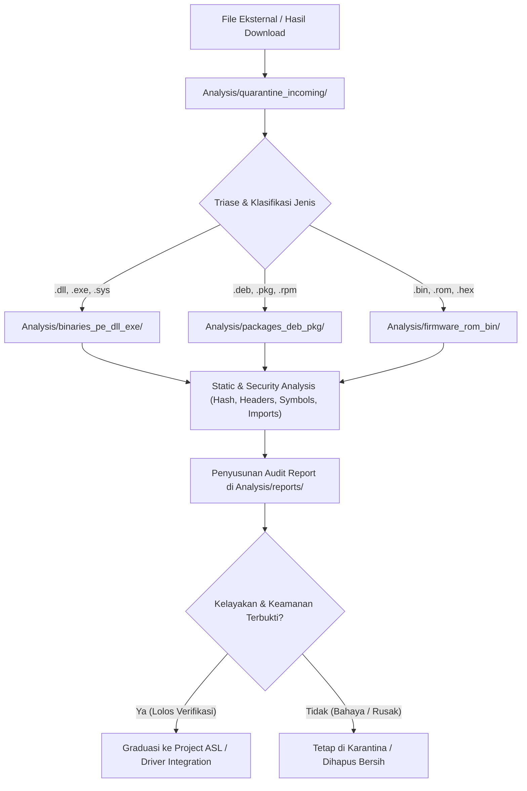

# STANDAR OPERASIONAL PROSEDUR (SOP) STAGING & ANALISIS FILE ASL
**Direktif Isolasi, Karantina, Pengelompokan, dan Verifikasi Berkas Eksternal**

---

## 1. TUJUAN & PRINSIP UTAMA
Sesuai kesepakatan dan direktif pengguna, seluruh berkas biner eksternal, artefak hasil unduhan (*download*), pustaka sistem (`.dll`, `.so`), berkas eksekusi (`.exe`, `.elf`), paket distribusi (`.deb`, `.pkg`, `.rpm`), maupun *firmware/ROM* (`.bin`, `.rom`, `.hex`) **DILARANG KERAS** diletakkan langsung ke dalam *root* proyek (`c:\asl\`) atau langsung diintegrasikan ke kode sumber utama kernel (`asl-kernel/`).

Semua berkas wajib masuk ke ruang karantina di folder [Analysis](file:///c:/asl/Analysis) terlebih dahulu, dikelompokkan secara rapi, dianalisis secara statis/dinamis, dan dinyatakan lolos uji sebelum metadata atau kodenya diizinkan masuk ke proyek inti ASL.

---

## 2. STRUKTUR DIREKTORI STAGING
Folder [Analysis](file:///c:/asl/Analysis) terbagi menjadi pos fungsional kedap udara berikut:

1. **`quarantine_incoming/`**
   * Pintu gerbang pertama untuk semua berkas baru yang diunduh, disalin dari sistem luar, atau diekstraksi.
   * Tidak boleh ada eksekusi langsung di folder ini sebelum proses triase.
2. **`binaries_pe_dll_exe/`**
   * Tempat penampungan berkas Windows PE, DLL, EXE, SYS, serta biner native Windows/DOS yang perlu dibedah strukturnya (*header inspection*, *import/export tables*, *relocation sections*).
3. **`packages_deb_pkg/`**
   * Tempat penampungan paket distribusi Linux (`.deb`, `.rpm`) dan Unix/macOS (`.pkg`, `.dmg`) untuk ekstraksi rootfs dan driver.
4. **`firmware_rom_bin/`**
   * Wadah untuk berkas firmware mentah (*raw flash dump*), ROM bootloader (U-Boot, UEFI, OpenSBI), dan citra mikrokontroler.
5. **`reports/`**
   * Arsip laporan hasil audit, dump string, disasimilasi, *hash verification*, dan ringkasan keselamatan teknis sebelum berkas dinyatakan lulus (*Graduation Certificate*).

---

## 3. ALUR KERJA (PIPELINE) ANALISIS FILE

---

## 4. TATA CARA ANALISIS & KRITERIA KELULUSAN (GRADUATION CRITERIA)
Setiap berkas yang masuk wajib menjalani inspeksi:
1. **Pencatatan Identitas Kriptografis:**
   * SHA-256 Hash
   * Ukuran berkas (*byte-level precision*)
   * Tanda tangan digital (*Digital Signature & Authenticode Check* jika ada)
2. **Inspeksi Struktur Berkas (Static Parsing):**
   * Arsitektur target (x86, x64, ARM, MIPS, RISC-V, dsb.)
   * Pemeriksaan pustaka dependensi (*Import Table*)
   * Ekstraksi fungsi yang diekspor (*Export Table*)
3. **Penyusunan Laporan di `reports/`:**
   * Nama laporan: `REPORT_<NAMA_FILE>_<TANGGAL>.md`
   * Memuat tabel integritas, hasil parsing, dan kesimpulan arsitektural.
4. **Izin Integrasi:**
   * Berkas asli tetap disimpan di pos [Analysis](file:///c:/asl/Analysis).
   * Hanya kode abstraksi Rust, header spec, atau firmware blob yang telah divalidasi yang boleh dimasukkan ke dalam sub-modul kernel ASL.

---

## 5. PENGAWASAN OTOMATIS (AUTOMATED HYGIENE)
Skrip pemeriksa kesehatan [tools/Sub_Assist.py](file:///c:/asl/tools/Sub_Assist.py) secara berkala memeriksa folder [Analysis](file:///c:/asl/Analysis) untuk memastikan:
* Tidak ada berkas liar yang tertinggal di luar sub-kategori resmi.
* Folder *root* proyek tetap bersih 100%.
