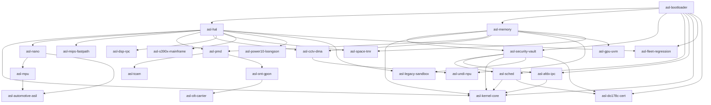

# ARCHITECTURE REVIEW: ASL CORE KERNEL
**Auditor:** Principal Software Architect & Systems Engineer  
**Date:** 2026-10-13  

---

## 1. REPOSITORY STRUCTURE & ECOSYSTEM
The ASL Core Kernel repository is structured as a modular Bare-Metal Rust workspace (`#![no_std]`) consisting of 25 distinct crates:

```text
c:\asl\asl-kernel\
├── Cargo.toml                     (Virtual Workspace Manifest)
├── asl-bootloader\                (Agnostic Bootloader Handover Protocol)
├── asl-hal\                       (Universal Hardware Abstraction Traits)
├── asl-memory\                    (Buddy & Fixed-Size Slab Page Allocator)
├── asl-security-vault\            (ARINC 653 Spatial Isolation Vault)
├── asl-sched\                     (Time-Triggered Major/Minor Frame Scheduler)
├── asl-afdx-ipc\                  (ARINC 664 Virtual Link Ring Buffer)
├── asl-kernel-core\               (Avionics Microkernel Aggregator & Entry)
├── asl-nano\                      (No-MMU Tickless RTOS Engine)
├── asl-mpu\                       (Hardware MPU 16-Region Abstraction)
├── asl-automotive-asil\           (Dual-Core Lockstep & CAN-FD Driver)
├── asl-mips-fastpath\             (CP0 TLB Refill Fastpath & Endianness Normalizer)
├── asl-pmd\                       (Polled-Mode Driver Zero-Copy DMA Rings)
├── asl-tcam\                      (Datacenter Switch TCAM Flow Ingestion)
├── asl-ont-gpon\                  (FTTH GPON GEM Framing & Hardware NAT)
├── asl-olt-carrier\               (Carrier-Grade OLT SR-DBA Engine)
├── asl-cctv-dma\                  (Quad-Buffering MIPI-CSI Video Pipeline)
├── asl-undi-npu\                  (Unified Neural Driver & Async Command Queue)
├── asl-dsp-rpc\                   (Lock-Free Mailbox Shared-Memory RPC)
├── asl-gpu-uvm\                   (Heterogeneous Unified Virtual Memory Manager)
├── asl-space-tmr\                 (SPARC LEON3 TMR Majority Voting & Scrubber)
├── asl-s390x-mainframe\           (IBM z16 Channel I/O & Storage Keys)
├── asl-power10-loongson\          (POWER10 MMA GEMM & LoongArch LBT Control)
├── asl-legacy-sandbox\            (Bare-Metal 6502/Z80/68k/8086 Sandbox)
├── asl-fleet-regression\          (150-Architecture Matrix Tracker)
└── asl-do178c-cert\               (DO-178C DAL-A Traceability Evaluator)
```

---

## 2. CORE COMPONENTS & INTER-MODULE DEPENDENCIES

### Dependency Graph


---

## 3. EXECUTION AND DATA FLOWS

1. **Bootstrapping Phase:**
   - External firmware/bootloader loads the kernel image and provides a populated `AslBootHandover` pointer to `_asl_kernel_entry` in `asl-kernel-core`.
   - `cold_boot_init` verifies magic signature `0x41534C5F424F4F54` and validates the physical memory map.
   - `BuddyAllocator` initializes available pages from usable RAM descriptor slices.
   - `SpatialPartitionManager` creates Partition 1 (Avionics Core Vault) and assigns the kernel physical memory window as Read-Execute (`PartitionAccessRights::ReadExecute`).
   - `MajorFrameSchedule` sets up deterministic 100ms major frame slots (20ms core, 80ms application).

2. **Hardware Partitioning & Traffic Shaping:**
   - Communication across partitions is constrained to the `AfdxVirtualLinkRingBuffer`, with Bandwidth Allocation Gap (BAG) timers preventing buffer flooding.
   - Microcontroller threads run within `asl-nano` constrained by `asl-mpu` 16-region address space bounds.

---

## 4. TRUST BOUNDARIES

1. **Firmware / Bootloader Boundary:**
   - Raw pointers passed into `_asl_kernel_entry` are fundamentally untrusted until `handover.validate()` runs.
2. **Partition Isolation Boundary (ARINC 653):**
   - Each partition is isolated within static `MemoryWindow` ranges. Code executing in one partition cannot touch another partition's address space.
3. **Network Ingress / PMD Ring Boundary:**
   - Ingress packets from the physical SerDes/Ethernet controller enter the `rx_ring` via DMA. Ownership bits coordinate hardware and host.
4. **Untrusted Legacy Binary Boundary (`asl-legacy-sandbox`):**
   - Untrusted legacy code (e.g. vintage ROMs or third-party bytecode) runs inside `SandboxedLegacyContainer` with a 64KB isolated virtual RAM limit.

---

## 5. ARCHITECTURAL WEAKNESSES & RECOMMENDATIONS

1. **Single-Node Monolithic Structs (Global State Limitations):**
   - Several crates (`BuddyAllocator`, `ZeroCopyPmdQueue`, `AfdxVirtualLinkRingBuffer`) rely on flat mutable references without concurrency primitives (no atomic CAS, spinlocks, or re-entrancy protection). If executed on multi-core SMP systems, concurrent access will cause data races.
   - *Recommendation:* Introduce architecture-specific Atomic primitives or SMP spinlocks for multi-core configurations.

2. **Static Fixed-Array Sizing:**
   - Partition tables (`MAX_PARTITIONS = 32`), memory map descriptors (`MAX_MEMORY_MAP_ENTRIES = 128`), and TCAM tables (`MAX_TCAM_TABLE_CAPACITY = 64`) have hardcoded static bounds.
   - *Recommendation:* Keep static limits for DO-178C determinism, but make limits configurable via compile-time feature flags.
